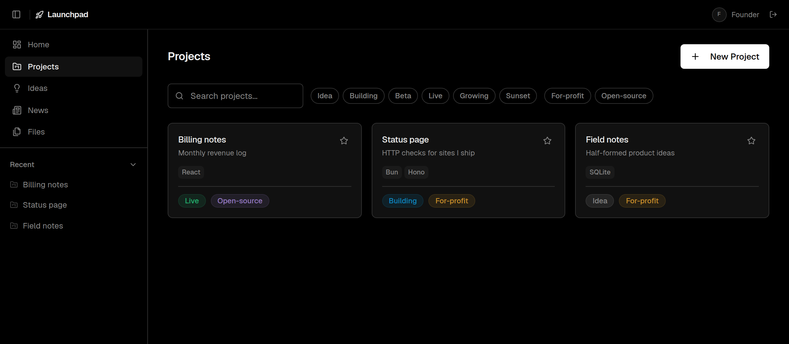

# Launchpad

Launchpad is a self-hosted founder command center for one person. It tracks projects, ideas, revenue, legal compliance, tech debt, and daily activity on a server you run yourself.



Status: finished, November 2026. Every feature under "What it does" was built in April 2026; since then it gets fixes and security patches only.

## What it does

- **Project pipeline**: stage-aware tracker (idea → building → beta → live → growing → sunset)
- **Idea inbox**: capture raw ideas before they slip away
- **MRR tracking**: revenue history with month-over-month scoreboard
- **Launch checklist**: 84 items for a for-profit project, 75 for open source, split by stage
- **Tech debt tracker**: severity × effort triage
- **Goals**: numeric targets with progress tracking
- **Legal compliance**: curated catalog for 12 countries and the EU, with an optional LLM review
- **GitHub integration**: commits, PRs, and issues per project
- **News feed**: Hacker News + RSS with LLM relevance scoring
- **Site monitoring**: built-in HTTP pinger, Telegram alerts on down/recovery, no external service
- **Telegram bot**: capture ideas by message + receive a morning briefing
- **MCP connector**: Claude (Code, Desktop, Claude.ai) reads your project data and writes build-log / tech-debt entries directly. See [docs/mcp-setup.md](docs/mcp-setup.md)

## Tech stack

- **Runtime**: [Bun](https://bun.sh)
- **Backend**: [Hono](https://hono.dev) on Bun; raw SQL via `bun:sqlite`; in-code migrations
- **Frontend**: React 18 + TypeScript + React Router v6 + TanStack Query v5
- **Styling**: Tailwind CSS + shadcn/ui
- **AI**: Anthropic Claude (configurable: Anthropic / Ollama / OpenAI-compatible)

## Self-host quickstart (Docker)

1. **Clone:** `git clone https://github.com/glebstarchikov/Launchpad && cd Launchpad`
2. **Env:** `cp .env.example .env`, then set `JWT_SECRET` (`openssl rand -hex 32`) and `LAUNCHPAD_USER_EMAIL`
3. **Up:** `docker compose up -d`
4. **Visit:** http://localhost:3001

Success looks like this: `docker compose ps` shows the container healthy, and http://localhost:3001 is the Launchpad sign-in page. Register on that first visit. Registration closes once a user exists. This is by design for a single-user app.

Data is persisted in Docker volumes (`launchpad_data` for the SQLite DB, `launchpad_uploads` for files).

For Coolify deployment, the full env reference, and Telegram setup, see the **Deployment: Coolify**, **Environment variables**, and **Telegram bot setup** sections below. For the MCP (Claude connector) setup, see [docs/mcp-setup.md](docs/mcp-setup.md).

### Pre-built image (faster)

Skip the build step by using the pre-built image from GitHub Container Registry. Replace the `build: .` line in `docker-compose.yml` with:

```yaml
image: ghcr.io/glebstarchikov/launchpad:latest
```

## Deployment: Coolify

1. New Resource → Application → select your GitHub repo → branch `main`
2. **General tab:**
   - Build Pack: `Docker Image`
   - Docker Image: `ghcr.io/glebstarchikov/launchpad:latest`
   - Ports Exposes: `3001`
3. **Environment Variables tab** → click **Developer view** → paste the contents of `.env.example` and fill in your values
4. **Persistent Storage tab** → add two volumes:
   - Destination: `/data` (SQLite database)
   - Destination: `/uploads` (file attachments)
5. Deploy, then open the URL and register your account immediately

> The pre-built image (`ghcr.io/glebstarchikov/launchpad:latest`) is updated automatically on every push to `main` via GitHub Actions.

## Local development

**Requirements:** [Bun](https://bun.sh) ≥ 1.0

```bash
bun install
cp .env.example .env   # set JWT_SECRET and LAUNCHPAD_USER_EMAIL
bun dev
```

Success looks like this: the log prints `Launchpad running at http://localhost:3001`, and that URL shows the sign-in page.

## Environment variables

See [`.env.example`](.env.example) for the full list with comments. Required:

| Variable | Description |
|---|---|
| `JWT_SECRET` | Long random string, generate with `openssl rand -hex 32` |
| `LAUNCHPAD_USER_EMAIL` | Your login email, must match the email you registered with; used by the Telegram bot and cron |

Optional integrations:

| Variable | Description |
|---|---|
| `LLM_PROVIDER` | `anthropic` or `ollama` (default) |
| `LLM_API_KEY` | Anthropic API key (if using anthropic provider) |
| `GITHUB_PAT` | GitHub personal access token (repo:read scope) |
| `TELEGRAM_BOT_TOKEN` | Telegram bot token from @BotFather |
| `TELEGRAM_CHAT_ID` | Your Telegram chat ID (from @userinfobot) |
| `TELEGRAM_BRIEF_HOUR` | Hour (0 to 23) for morning briefing in server local time (default: 9) |
| `WHISPER_MODEL_PATH` | Path to whisper.cpp model for voice idea capture |
| `MCP_API_KEY` | Bearer key for the MCP connector, generate with `openssl rand -hex 32`. Leave blank to disable. |

## LLM features

Launchpad optionally uses an LLM for:
- Daily morning briefing summary (via Telegram)
- Legal compliance item personalization when adding a country
- On-demand legal compliance review (diff against curated catalog)

**Ollama (local, free):**
```bash
ollama serve
ollama pull llama3.1
# .env: LLM_PROVIDER=ollama
```

**Anthropic:**
```bash
# .env:
# LLM_PROVIDER=anthropic
# LLM_API_KEY=sk-ant-...
```

## Telegram bot setup

1. Create a bot via [@BotFather](https://t.me/botfather) → get `TELEGRAM_BOT_TOKEN`
2. Get your chat ID via [@userinfobot](https://t.me/userinfobot) → set `TELEGRAM_CHAT_ID`
3. Set both in `.env` and restart

Once configured:
- Send any message to the bot → saved as an idea in Launchpad
- Every morning at `TELEGRAM_BRIEF_HOUR` (default: 9 AM server time) → briefing with yesterday's summary + top news signals

## Resetting your password

```bash
# Docker
docker exec -it <container_name> bun scripts/reset-password.ts you@email.com newpassword

# Local dev
bun scripts/reset-password.ts you@email.com newpassword
```

## Upgrading

Schema migrations run automatically on startup. Pull and restart:

```bash
git pull
docker compose up -d --build
```

## Tests

```bash
bun test server/tests/
bun run build
```

`bun run build` writes the production client bundle to `client/dist/`. CI runs `bun install --frozen-lockfile`, then those two commands, on every push and pull request. The image publish workflow is separate and still runs only on pushes to `main`.

## Contributing

Issues and PRs welcome. Read [CONTRIBUTING.md](CONTRIBUTING.md) first. It covers local setup, testing conventions, and commit style.

## Security

Found a vulnerability? See [SECURITY.md](SECURITY.md) for the responsible disclosure process. Please **don't** open a public issue.

## License

MIT, see [LICENSE](LICENSE).

---
Part of what I build at [glebstarchikov.nl](https://glebstarchikov.nl).
